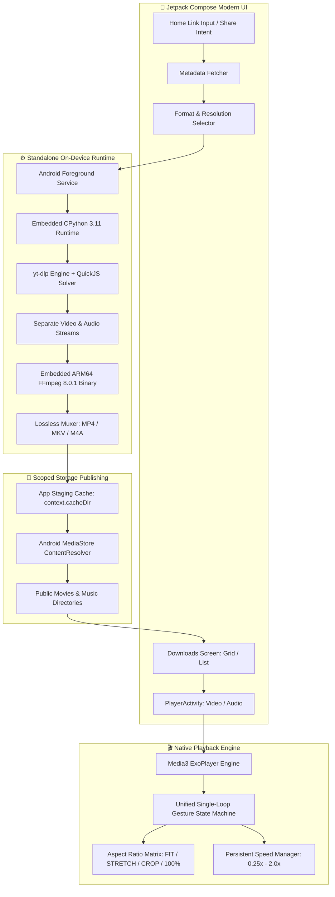

# 🎬 ytMax

<p align="center">
  
  
  
  
  
  
</p>

---

## 🌟 Overview

**ytMax** is an all-in-one, completely standalone, privacy-first Android media workstation. It combines:
1. **Ultra HD Media Downloader**: Extracts and losslessly merges YouTube video and audio up to **8K Ultra HD (4320p)** entirely on-device without remote servers, paid APIs, Termux, or root.
2. **Native MX Player-Style Video Player**: Complete with dual-zone vertical swipe gestures (Brightness/Volume), horizontal timeline scrubbing, 2-finger hardware zoom (up to 400%), 4-mode aspect ratio scaling (`FIT TO SCREEN`, `STRETCH`, `CROP`, `100%`), and a 2-second Touch & Hold 2X speed boost.
3. **Dedicated Audio Player**: Rich album artwork, format tags, auto-advancing playlists, and persistent playback speeds.
4. **Built-in Media Gallery & Image Viewer**: Dual-column grid/list view toggle, 6-way sorting, live search filtering, multi-select playlist queues, and protected thumbnail management.

> 📦 **Pre-Built Direct APK**: You can install `ytMax-v1.0.apk` directly from the root of this repository.

---

## 🚀 Key Features

### 📥 1. On-Device 8K Video & Audio Downloader
- **Zero Server Dependency**: 100% of extraction, deciphering, and multiplexing runs directly inside your phone's processor.
- **Full Resolution Spectrum**:
  - **8K** (4320p) & **4K** (2160p) Ultra HD
  - **2K** (1440p) Quad HD
  - **1080p** Full HD (60fps / High-Bitrate)
  - **720p**, **480p**, **360p**, **240p**, **144p**
- **Lossless Stream Multiplexing**: Embedded native **FFmpeg 8.0.1** losslessly muxes separate high-bitrate video (`DASH`) and audio streams (`Opus/AAC/M4A`) without re-encoding quality loss.
- **QuickJS Signature Decryption**: Bundles native `libqjs.so` to solve YouTube's `n-sig` JavaScript challenges on the fly.
- **Android Scoped Storage (Android 10 - 15+)**: Automatically registers finished media with Android's `MediaStore`, making it immediately visible in your phone's native gallery, VLC, and MX Player.
- **Foreground Service with Live Notification**: Prevents Android Doze mode and OS kills during long downloads with live percentage, speed (MB/s), and ETA progress bars.
- **One-Tap Share Intent**: Share directly from the official YouTube app or browser to ytMax.

---

### 🎥 2. Professional Native Video Player (Media3 ExoPlayer)
- **MX Player-Style 4 Aspect Ratio Modes**:
  - `FIT TO SCREEN`: Standard letterbox/pillarbox maintaining source ratio.
  - `STRETCH`: Expands video edge-to-edge without cropping.
  - `CROP`: Fills entire screen while maintaining aspect ratio (crops edges).
  - `100%`: 1:1 unscaled native resolution centered with black borders on all sides.
  - *Centered Extra-Bold HUD overlay on switch* (`FIT TO SCREEN`, `STRETCH`, `CROP`, `100%`).
- **Precision Gesture Controls**:
  - **Left Vertical Swipe**: Smooth screen brightness control ($0\%$ to $100\%$).
  - **Right Vertical Swipe**: Smooth system music volume control.
  - **Horizontal Swipe**: Timeline scrub/seek with live delta `+Xs / -Xs (MM:SS)` HUD.
  - **2-Finger Pinch Zoom**: Smooth hardware-accelerated zoom ($1.0\times$ to $4.0\times$) with floating quick-reset badge.
  - **Touch & Hold (2 Seconds)**: Automatically activates **2X Speed Boost** with top indicator pill; restores configured speed immediately on release.
  - **Double-Tap**: Left side rewinds 10s; right side forwards 10s.
- **Orientation Control**: Instant 1-tap toggle between portrait and sensor landscape.

---

### 🎵 3. Dedicated Audio Player & Global Speed Control
- **Rich Audio Interface**: Large rounded album artwork, song metadata, channel badges, and audio format tags (`MP3`, `M4A`, `OPUS`).
- **Auto-Advance Playlists**: Seamlessly advances to the next song/video upon track completion.
- **Universal Persistent Speed Engine**:
  - Choose between `0.25x`, `0.5x`, `0.75x`, `1.0x (Normal)`, `1.25x`, `1.5x`, `1.75x`, and `2.0x`.
  - Configured speed **persists across every video and audio file** and survives app restarts.
  - Subtle non-intrusive top-bar speed badge `[⚡ 1x]` and audio speed chip.

---

### 🗂️ 4. Downloads Manager & Gallery
- **Grid View & List View**: Instant header toggle between clean single-item rows and modern 2-column card grids.
- **Live Search**: Instant real-time filtering by video title or uploader channel.
- **6-Way Sorting**:
  - Newest First / Oldest First
  - Alphabetical (A-Z) / Reverse (Z-A)
  - File Size (Largest / Smallest)
- **Multi-Select Playlist Mode**: Select multiple downloaded items and tap **Play Selected** to launch a custom playlist queue.
- **Protected Image Viewer**: View full-size YouTube thumbnails with pinch-to-zoom, pan, and share. Deleting an image only deletes the image file—never touching the audio or video.

---

## 🏗️ Technical Architecture



---

## 🛠️ Complete Tech Stack

| Layer | Component | Description |
|---|---|---|
| **Language** | Kotlin 2.0 | Modern Android language with coroutines and flow architecture |
| **UI Framework** | Jetpack Compose | Declarative UI with Material 3 design tokens |
| **Image Loading** | Coil Compose | Asynchronous image loading and disk caching |
| **Media Player** | AndroidX Media3 (ExoPlayer) | Low-latency audio/video decoder with foreground service support |
| **Embedded Python** | CPython 3.11.11 | Statically linked for ARM64-v8a Linux Android |
| **Extraction Engine** | `yt-dlp` | Industry-standard metadata parser and adaptive stream extractor |
| **JS Challenge Solver** | QuickJS (`libqjs.so`) | Local engine to solve YouTube `n-sig` cipher transformations |
| **Multiplexer** | Native `ffmpeg` & `ffprobe` | Pre-compiled static binary executing with `chmod 0755` permissions |
| **Storage Architecture** | Android Scoped Storage | `MediaStore.Video`, `MediaStore.Audio`, and Storage Access Framework |
| **Background Processing** | Android Foreground Service | `ServiceInfo.FOREGROUND_SERVICE_TYPE_DATA_SYNC` with ongoing notifications |

---

## 📖 The 30-Hour Engineering Odyssey: From ₹0 to True Independence

This project was born out of **over 30 hours of relentless research, intense 10-hour non-stop focus sessions, day-and-night testing, and hundreds of experiments**.

### 1. The Cross-Platform Trap
We initially tested building a cross-platform client (Flutter/Dart + local backend). It immediately broke down against YouTube's anti-scraping infrastructure:
* **The 360p Lock-In**: Without a local muxer, pure HTTP scrapers could only download legacy 360p progressive files. 1080p, 4K, and 8K use DASH (separate audio/video streams) that require on-device merging.
* **The 3–6 MB Cutoff**: Downloads consistently stalled after downloading a few megabytes due to throttled chunk responses.
* **Bot Challenges**: Direct requests were blocked with `HTTP 403 Forbidden` and `"Sign in to confirm you're not a bot"`.

### 2. The Cloud Hosting Experiment
We attempted hosting the Python extraction backend on free cloud platforms:
* **Hugging Face Spaces**, **Railway**, **Fly.io**, **Vercel**, **Render**, and **Netlify**.
* **Result**: Complete failure. YouTube maintains strict IP reputation blocks on known data-center CIDR blocks. Every cloud host was immediately blacklisted.

### 3. The Research Marathon
Determined to keep the app **100% free with ₹0 hosting costs**, we studied:
* Leading open-source projects (**Seal**, **YTDLnis**, **ElePlay**).
* Frontier AI models (**ChatGPT**, **Google Gemini**, **DeepSeek**, **Claude Sonnet**).
* Official Android OS internals, SELinux policies, and ExoPlayer source code.

### 4. The Prototype & The Mobile Breakthrough
* First, we engineered a desktop Python prototype (`downloader.py`) on Windows using `Tkinter`, `yt-dlp`, and native `ffmpeg`. It proved that a local, direct connection could extract and download up to **8K resolution** without rate limits or cloud servers.
* We then asked: *"Why not bundle this entire desktop pipeline inside an Android APK?"*
* We engineered **ytMax**:
  1. Extracted and unpacked CPython 3.11 and native ARM64 FFmpeg binaries on first boot into the app's private files directory.
  2. Solved Android SELinux permissions using programmatic `chmod 0755` and dynamic `LD_LIBRARY_PATH` loading.
  3. Solved Android Doze mode using a formal Android Foreground Service with wake-locks and notification progress bars.
  4. Solved Scoped Storage by staging downloads in cache and publishing completed merges to `MediaStore`.
  5. Built an integrated Media3 ExoPlayer with gesture disambiguation, MX Player scaling modes, and 2-second 2X speed hold.

---

## 📲 How to Install & Run

### Method 1: Direct APK Install (Recommended)
1. Download `ytMax-v1.0.apk` from the root of this repository.
2. Transfer it to your Android device (or download directly on your phone).
3. Tap the file to install (allow "Install from Unknown Sources" if prompted).
4. On first launch, the app will initialize the internal Python and FFmpeg engines in ~3 seconds.

### Method 2: Install via ADB
```bash
# Connect phone via USB with USB Debugging enabled
adb install -r ytMax-v1.0.apk
```

### Method 3: Build from Source
```bash
# Prerequisites: JDK 17, Android SDK API 35
git clone https://github.com/<your-username>/ytMax.git
cd ytMax

# Compile Debug APK
./gradlew assembleDebug

# Install compiled APK
adb install -r app/build/outputs/apk/debug/app-debug.apk
```

---

## 🔒 Privacy & Independence

* **₹0 Lifetime Cost**: No server subscriptions, no VPS hosting, no paid third-party proxies.
* **100% Local & Private**: All network traffic goes directly between your device and the media source. No telemetry, no data collection, no intermediary tracking servers.
* **Customizable & Open**: You own the code, the binary engine, and the APK.

---

## 📄 License
This project is open-source under the [MIT License](LICENSE).
